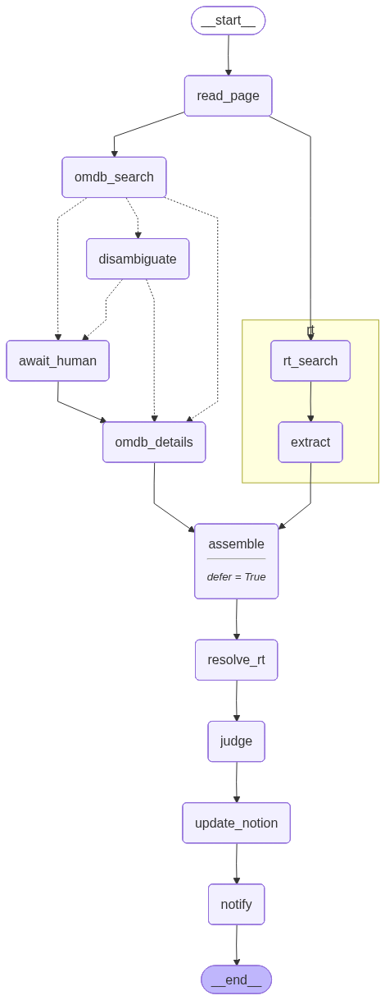

# Notion Movie/TV Enrichment Agent

A LangGraph/LangChain service that enriches a Notion **Watchlist** with IMDb rating,
Rotten Tomatoes scores, plot, and genre. 

Design docs: [`CONTEXT.md`](CONTEXT.md) · [`RESEARCH.md`](RESEARCH.md) ·
[`docs/adr/`](docs/adr) · [`TASKS.md`](TASKS.md).


# Preview 

https://github.com/user-attachments/assets/2592c712-a857-41c2-bbc9-78a015647c74

## The enrichment graph

Uses OMDB AI as the authoritative source to find movies, fetches Rotten Tomatoes scores with best effort using Tavily/Exa/Firecrawl.

If there are multiple matches, posts a message on Slack (HITL) asking user to confirm.

Running on OpenRouter with `openai/gpt-5.4-nano` currently in prod, with traces uploaded to LangSmith.




Regenerate the diagram: `uv run python -m notion_db_updater --generate-graph`.

## Running it

Requires `uv`. Copy `.env.example` → `.env` (only `NOTION_MOVIE_DB_TOKEN` is needed to boot).

```bash
uv run python -m notion_db_updater                    # read + print the Watchlist
uv run python -m notion_db_updater --enrich <page_id> # enrich ONE Entry
uv run python -m notion_db_updater --reconcile        # sweep the whole Watchlist once
uv run python -m notion_db_updater --serve            # in-process cron loop
```

## Deploy (Docker Compose, always-on)

Phase 10 (ADR 0009 / 0007) — one long-lived container running `--serve` (in-process cron +
Slack Socket Mode), kept up by `restart: always`. No inbound HTTP (Socket Mode is an outbound
WebSocket), so no ports are exposed.

```bash
make secrets              # project .env's 9 secret keys into secrets/* (gitignored)
docker compose up --build # start the always-on agent
```

- **Secrets** are file-mounted (`docker-compose.yml` → `secrets:`), never baked into the image
  or the compose file. `make secrets` regenerates `secrets/*` from `.env` — rerun after
  rotating a key. `entrypoint.sh` bridges `/run/secrets/*` into env vars on boot.
- **State** (the SQLite checkpointer) lives on the **named volume** `checkpoint-data`, so a
  paused `awaiting_input` HITL run survives a container restart (ADR 0007).
- **Config** — `OPENAI_BASE_URL` and all non-secret tuning (intervals, RPMs, models, LangSmith
  project) are read from `.env`/env via compose `environment:` with sensible defaults. A remote
  LLM endpoint (e.g. OpenRouter) works as-is; for a host-local LLM use
  `http://host.docker.internal:8888/v1` (and on Linux add
  `extra_hosts: ["host.docker.internal:host-gateway"]` to the service).

Verify durability: create an ambiguous Entry → it goes `awaiting_input` → `docker compose
restart` mid-wait → the paused graph resumes from the volume-backed `.sqlite`.

## Conversational Movie Bot

Configure `OPENAI_AGENT_MODEL` with a tool-calling model. All incoming user messages and
interactive actions are treated as yours; no Slack user allowlist is configured.
The agent uses the existing endpoint, API key, retry policy, and optional reasoning setting.

Verify the live schema, then explicitly add the missing `IMDb ID` rich-text property:

```bash
uv run python -m notion_db_updater --check-watchlist-schema
uv run python -m notion_db_updater --prepare-watchlist
```

The preparation command validates the existing `Watched` checkbox and adds only a missing
identity property. A matching legacy title or alias shows a confirmation card with the existing
Notion Entry and proposed IMDb title, year, and type. Confirming fills only the missing IMDb ID;
rejecting leaves the Entry unchanged. Confirmations expire after 30 minutes,
and survive restarts. Changed or removed Entries are rechecked before any write.
The check is bounded to 25 unidentified legacy Entries; unresolved titles still need manual
verification. Pending sweep Entries populate their
identity during Enrichment once conversations are enabled.

Slack needs `app_mention` plus message subscriptions for the channel types you use:
`message.channels` / `channels:history` for public channels, `message.groups` /
`groups:history` for private channels, or `message.im` / `im:history` for DMs. Retain existing
`app_mentions:read` and `chat:write` scopes, Socket Mode, and interactivity. Reinstall the app
after changing scopes. See [Slack message events](https://docs.slack.dev/reference/events/message.channels/).

Mention the bot to start, then reply normally within that thread.

Each request shows a working message in its thread. Real tool operations update that message
with progress such as web searches and IMDb matching; the final answer replaces it.
The native working indicator uses agent session status, with assistant thread status as a
fallback when the session API is unavailable. Long requests refresh the indicator every minute.

- `@Movie Bot add Lone Survivor and Black Hawk Down`
- `@Movie Bot add the movies from https://example.com/list`
- `@Movie Bot give me some unwatched recommendations`
- `mark the second one watched`, `remove Black Hawk Down`, or `refresh Lone Survivor`

All writes are staged before execution. Four or more distinct Entries across a request
require approval; every URL Import requires a preview. Ambiguous write intent also gets a
preview with selectable changes and Approve/Deny buttons. Select the changes to apply, then
click Approve selected, or Deny to cancel the plan. Approval expires after 30 minutes and
applies only once to that exact plan. Removal moves an Entry to Notion trash, and refresh preserves viewing
state, title, type, and identity. Requests and references persist in the checkpoint database.

Default recommendations use up to five existing unchecked Watched Entries. Explicit discovery
can search outside the Watchlist; suggestions do not Add anything. Web research uses Firecrawl
search and cites its evidence. Initial limits are three searches and 25 staged actions per request;
the supplied page is scraped once through Firecrawl, without crawling linked pages.
Firecrawl owns URL validation, DNS resolution, network access, and redirects; the bot never connects
to supplied pages directly. Provider responses have a 1 MB ceiling and page text has a
64,000-character agent-context ceiling. Limits are reported with an explicit continuation
option. Raise the configuration ceilings deliberately after evaluating behavior.

```bash
make test             # deterministic tools/approvals/recovery and real graph fixtures
make check            # formatting, lint, types
make evaluate-agent   # opt-in real model calls; fixture tools, no Slack/Notion writes
```

Model evaluation and controlled Slack/Notion test-database verification are separate from
deterministic tests. An interrupted external write with an unconfirmed outcome is reported
as uncertain and is never blindly repeated. Inspect current Watchlist state before retrying.
